  

  
  

  

  <a href="https://portfolio-ud9p.vercel.app/">Portfolio</a> ·
  <a href="https://www.linkedin.com/in/arunlal-pp/">LinkedIn</a> ·
  <a href="mailto:arunlalpp@gmail.com">Email</a>

Cards are animated SVGs generated by <code>scripts/render_readme_cards.py</code> and refreshed daily by a GitHub Action.

<!-- 

 

  <a href="https://github.com/Arunlalpp">
  

 

 

 

 
<h3>Things I code with</h3>

  
  
  
  
  
  
  
  
  
  
  
  
  

 
 
 
-->
 Hey, I'm Arunlal PP

Front-end developer React | React-native | Nuxt 

## 🌐 Socials:
    

# 💻 Tech Stack:
                       

## 🏆 GitHub Trophies

---

<!-- Proudly created with GPRM ( https://gprm.itsvg.in ) -->
